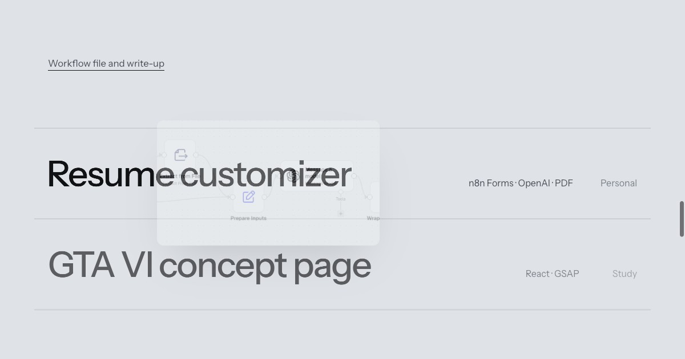

# Akash Dangwal — portfolio

Live: **https://akash-dangwal.github.io/**

Personal site of Akash Dangwal, freelance AI automation & integration developer.
It shows four n8n workflows I built (exports and write-ups are in
[n8n-automation-portfolio](https://github.com/Akash-dangwal/n8n-automation-portfolio)),
what I can help with, and how to get in touch.



## How it's built

- Plain `index.html`, `styles.css` and `main.js`. No framework, no build step.
- Type: Instrument Sans. Motion: GSAP + ScrollTrigger and Lenis smooth scroll, both
  loaded from a CDN with integrity hashes. Everything works without JavaScript and
  respects `prefers-reduced-motion`.
- Hosted on GitHub Pages from the `main` branch.

## Run locally

```bash
python3 -m http.server 8765
# open http://localhost:8765
```

## Contact

dangwalakash07@gmail.com · [LinkedIn](https://www.linkedin.com/in/akashdangwal07/)
